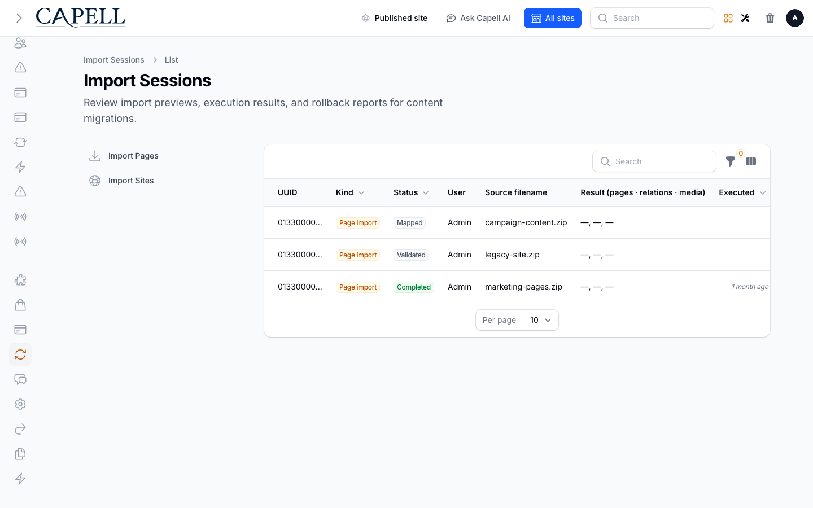
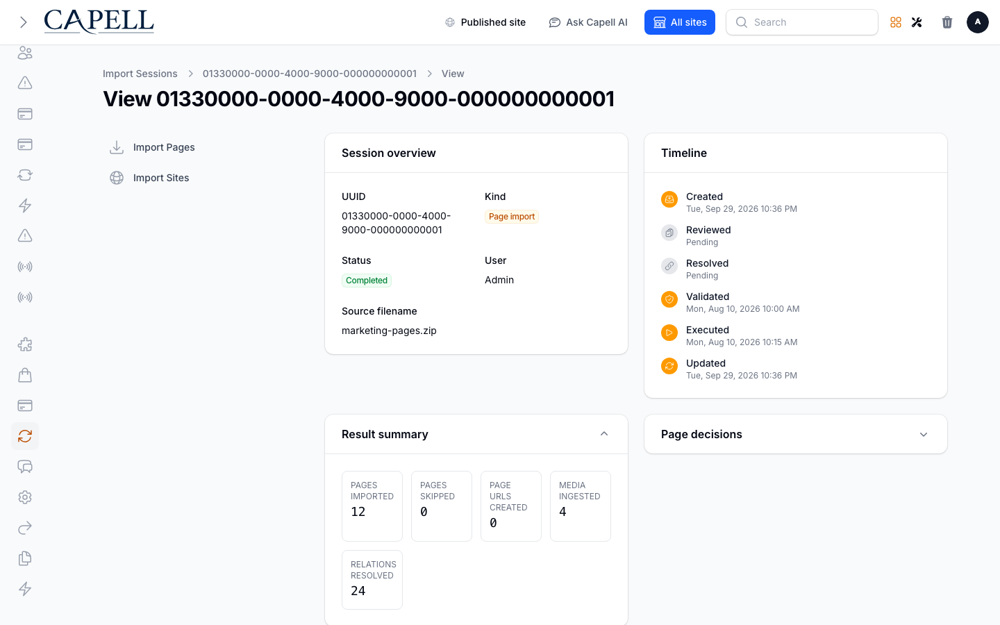

# Migration Assistant

<!-- prettier-ignore-start -->

## What It Does

Migration Assistant adds staged import sessions for mapping, validating, executing, reviewing, retrying, and rolling back external content imports.

- **Price and availability:** Check current availability and price on the [Capell Marketplace listing](https://capell.app/extensions/migration-assistant).
- **Licence:** Check the licence terms on the [Capell Marketplace listing](https://capell.app/extensions/migration-assistant).
- **Requires:** `PHP ^8.4`, `capell-app/admin ^1.0.66`, `capell-app/core ^1.0.75`, `illuminate/database ^11.0|^12.0|^13.0`, `illuminate/support ^12.41.1|^13.0`, `lorisleiva/laravel-actions ^2.8`, `spatie/laravel-package-tools ^1.15`.
- **Install:** `composer require capell-app/migration-assistant`.

Admins can upload or select source data, map it to Capell records, validate the plan, run the import, and inspect row-level results.

## Who It Is For

**For developers:** Source, target, and executor registries support file and database imports; database executors validate a previewed schema and track source keys for repeat imports.

**For teams:** Teams can review migration problems before content is written and keep a recovery path when an import needs to be undone.

## Quick Start

1. Install the package: `composer require capell-app/migration-assistant`.
2. Open the package admin surface at `/admin/migration-assistant/import-sessions` and confirm Migration Assistant is available.

## Configure

- **Configuration files:** `config/migration-assistant.php`.
- **Commands:** `php artisan migration-assistant:export`, `php artisan migration-assistant:import`, `php artisan migration-assistant:prune`, `php artisan migration-assistant:reclaim-stale`, `php artisan migration-assistant:rollback-execute`, `php artisan migration-assistant:rollback-report`, `php artisan migration-assistant:status`.

## Limits And Pitfalls

- Install the required Capell packages at the versions in `composer.json`: `capell-app/admin ^1.0.66`, `capell-app/core ^1.0.75`.
- Run migrations before opening package resources or public routes.
- Keep the host Laravel scheduler running so package-registered schedules can execute: `migration-assistant:reclaim-stale (everyTenMinutes; manifest declared)`.

## Screens And Workflow

- Import session index or host admin surface (admin).
- Import validation summary (admin).
- Completed page import and recovery report (admin).
- Relation resolution review (admin).
- Rollback report view (admin).
- Import session index or host admin surface with admin sidebar menu open (admin).

## Install Impact

- Required packages: `capell-app/admin`, `capell-app/core`.
- Admin navigation: declares `admin-page: ImportPagesPageContribution`, `admin-page: ImportSitesPageContribution`, `admin-resource: ImportSessionResourceContribution`; each Filament page or resource controls its own navigation visibility.
- Admin/editor extensions: none declared.
- Permissions: `page.export`, `page.import`, `page.import.update-shared-relations`, `page.import.publish-live`, `import-session.view`, `import-session.cancel`, `import-session.retry`, `import-session.rollback`, `import-session.legal-hold`; Shield-generated page permissions for `Capell\MigrationAssistant\Filament\Pages\ImportPagesPage` (names and grants depend on host Shield configuration); access also governed by package policies: `ImportSessionPolicy`.
- Public routes: none declared.
- Database changes: package migrations are declared.
- Config: `config/migration-assistant.php`.
- Settings: no package settings declared.
- Queues or schedules: scheduled commands `migration-assistant:reclaim-stale (everyTenMinutes; manifest declared)`; queue jobs `ExecuteImportPlanJob`.
- Cache tags: none declared.
- Commands: `migration-assistant:export`, `migration-assistant:import`, `migration-assistant:prune`, `migration-assistant:reclaim-stale`, `migration-assistant:rollback-execute`, `migration-assistant:rollback-report`, `migration-assistant:status`.

## Troubleshooting

| Symptom | Likely cause | Check | Fix |
| --- | --- | --- | --- |
| Package surface is missing after install | Provider or manifest is not loaded | Confirm `capell.json`, package `composer.json`, and provider registration | Reinstall the package, refresh Composer autoload, and clear host caches |
| Admin screen or command fails on missing table | Package migrations have not run | Check the tables listed in `Data Model` | Run host migrations and rerun the focused package test |
| Background work does not run | Queue worker or declared schedule is not active | Check the jobs and scheduled commands listed in `Technical Shape` | Start the queue worker or host scheduler, then run the focused command or package test |

## Upgrading

No manual steps between minor versions.

Read [CHANGELOG.md](CHANGELOG.md) before upgrading.

## Next Steps

- [Package docs](docs/README.md)
- [Overview](docs/overview.md)
- [Worked extension examples](docs/extension-contracts.md)
- [Admin guide](docs/admin-guide.md)
- Configuration files: [`config/migration-assistant.php`](config/migration-assistant.php).
- [Troubleshooting](#troubleshooting)
- [Developer reference](docs/reference.md)
- [Marketplace assets](docs/assets/marketplace/)
- [Capell content language plan](../../docs/CONTENT_LANGUAGE_PLAN.md)
- [Capell documentation design system](../../docs/DESIGN_SYSTEM.md)
- [Capell and package ERD notes](../../docs/erd/capell-and-package-erds.md)
- Related packages: [Blog](../blog/README.md), [HTML Cache](../html-cache/README.md), [Media Library](../media-library/README.md), [Navigation](../navigation/README.md), [SEO Suite](../seo-suite/README.md), [Site Discovery](../site-discovery/README.md), [URL Manager](../url-manager/README.md), [WordPress Importer](../wordpress-importer/README.md).

<!-- prettier-ignore-end -->
