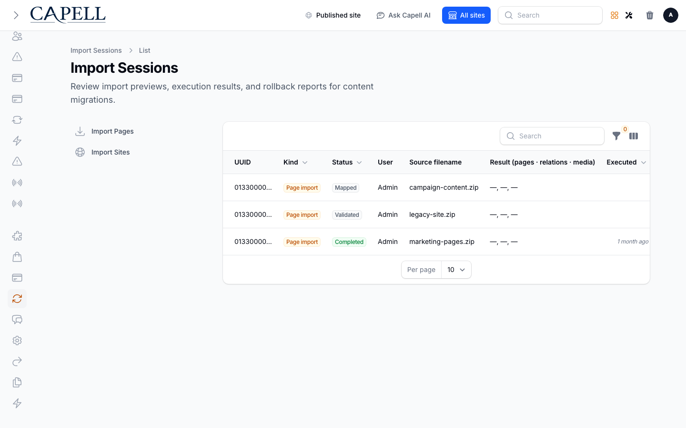
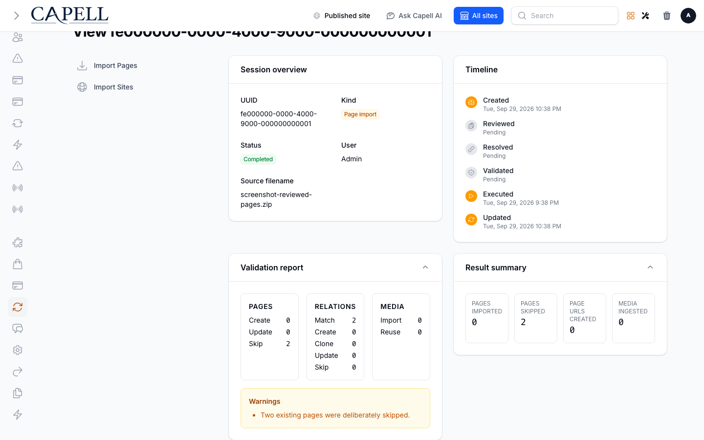
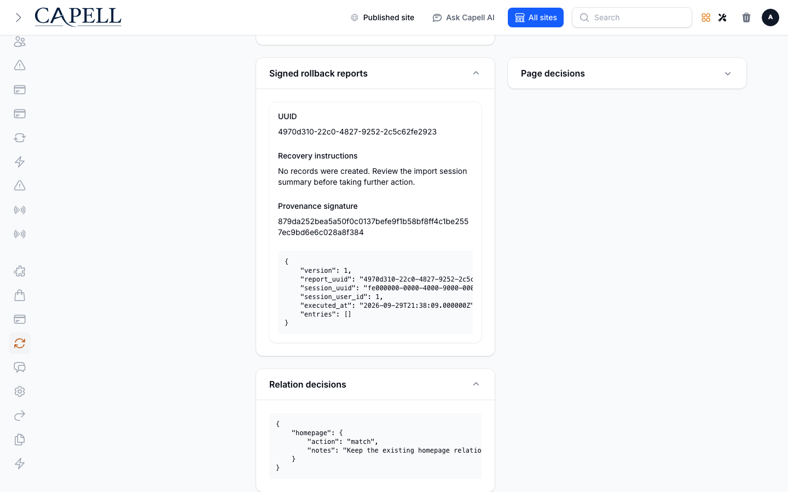
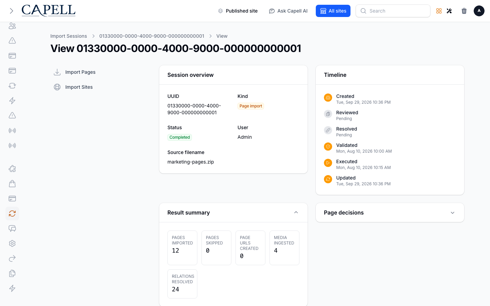
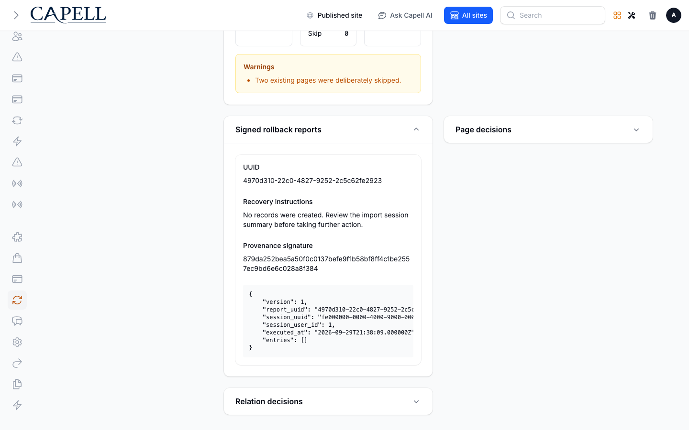

# Using Migration Assistant

This guide is for editors running a content import and owners planning a migration. Every step uses the labels you see on screen.

## Using Migration Assistant (editor how-to)

### How to start an import

1. Open **Developer > Import sessions** and choose **Import pages** or **Import sites**.
2. Upload the Capell package archive (`.zip`), give the workspace a name, and optionally add a note.
3. Continue to create an import session you can return to from **Import sessions**.

### How to review imported pages

1. After the archive is read, review each proposed page action.
2. Keep the proposed action, skip an item, or record a note where the preview needs a decision.
3. Continue to relation resolution when the page review is complete.

### How to check validation before importing

1. Complete page review and relation resolution, then open the validation step.
2. Read the errors and warnings for the package and your decisions.
3. Fix the package or review decisions for anything marked as an error, then validate again.
4. Warnings do not block dispatch, but each needs a deliberate review decision. Resolve the warning or record why you accept its consequence in the relevant page or relation review notes before confirming the import.

A `create` decision whose URL already exists on a live page requires you to check the affected page and intended destination: change the URL, choose the correct update target, or skip it as appropriate. A low-confidence relation alternative shows the reference, candidate record and confidence; inspect those records and choose the intended match rather than trusting the suggested mapping. Return to validation after changing a decision. A warning is not an assurance that the import is correct. Keep a current backup and preview a small sample before the full run.

### How to match references to existing records

1. When your import links to other content (for example an author or a category), open the relation review step.
2. For each imported reference, choose the matching record that already exists in Capell.
3. Save your choices before you run the import, so links point to the right place.

### How to validate and run

1. Use the page review and validation steps to see what will be imported.
2. Check the validation summary carefully before dispatching.
3. Confirm the import when prompted, then let the queued job run.

### How to import pages through Recovery Center

1. Open **Developer > Import sessions** and choose **Import pages**.
2. Upload a Capell page package, then work through page review, relation resolution, and validation.
3. Dispatch the import and watch its progress.
4. If something goes wrong, note the import reference and problem details and ask an authorised administrator to assess recovery. Rollback runs from the command line; this screen has no rollback button.

### How to review the results

1. Open the finished import session.
2. Read the status and the list of anything that was skipped.
3. Fix and re-import any items that didn't come across.

### How to undo an import

1. As an editor, give your administrator the import reference and the errors or unexpected results you can see. You may not have access to the session or its reports.
2. A global administrator with `import-session.view` opens the session and reads its rollback reports. With a current backup, the operator inspects `migration-assistant:rollback-report <session-id-or-uuid>` and runs `migration-assistant:rollback-execute <session-id-or-uuid> --actor=<user-id> --dry-run`.
3. After reviewing the proposed deletions, an authorised operator runs that execution command without `--dry-run`. The named actor must hold `import-session.rollback` and be permitted to delete the affected records. Review the resulting audit and manual instructions.

Rollback only removes recorded creations that are unchanged. It skips edited records and does not restore edits to reused records, external effects or backups. Follow the [rollback procedure and recovery limits](overview.md#roll-back-created-records) before executing it; skipped records need an administrator's manual recovery assessment.

### How to export content as a package

1. Choose to create an export package.
2. Confirm which resources are included before you download.
3. Download the package so you can move that content to another site.

## Rolling out Migration Assistant (for owners)

### Turn on first

- A backup and a small test import. Always back up first, then import a small batch to confirm the mapping before importing everything.

### Add when needed

| Need                               | Enable                                                   |
| ---------------------------------- | -------------------------------------------------------- |
| Import from a specific system      | The matching source (for example the WordPress Importer) |
| Repeat or resume a large migration | Multiple import sessions                                 |

### Don't enable yet

- Don't run a full import before previewing a sample. Map and preview first, then run.

### Who does what

| Role       | First useful screen                                 |
| ---------- | --------------------------------------------------- |
| Editor     | Recovery Center: review, resolve, validate, and run |
| Site owner | **Import sessions**: track progress and results     |

## Troubleshooting for editors

| What you see                              | What it means                                                   | What to do                                                                |
| ----------------------------------------- | --------------------------------------------------------------- | ------------------------------------------------------------------------- |
| Imported content is not what you expected | The page review or relation decisions were incorrect            | Fix the package or decisions, then create a new import session            |
| Some items were skipped                   | The review or validation found a blocking issue                 | Review the session result, fix the package or decisions, and import again |
| The import session will not start         | The archive was missing, unreadable, or not a valid package     | Upload a valid Capell ZIP package and check the validation message        |
| Images did not come across                | The package did not contain usable media, or ingest rejected it | Check the rollback/result report and package media before trying again    |

## File readers and command-line review

The shipped Import Pages wizard accepts Capell ZIP archives. CSV, XML and spreadsheet readers and field mapping are APIs for integrations; the wizard does not offer a CSV/XML upload or mapping screen. The target registry contains `page`, `type` and `collection` mappings for integrations; these do not add target choices or mapping screens to the wizard. The default page resolver is the live database unless an enabled integration replaces it.

`migration-assistant:import <archive>` validates without executing. `--execute` queues the validated import and `--sync` executes it immediately in the foreground. Both writing paths require `--actor=<user-id>` and recheck that actor's import permission and site scope. The CLI is a trusted operator path: it does not require the wizard's interactive review or confirmation phrase. Preview a small sample and inspect the validation result before choosing either writing option. Retention pruning remains an explicit operator command; the stale-session reclamation schedule does not prune retained evidence.

Version-one rollback reports preserve each failed deletion in place and report `delete_failed`, while recovering other independent recorded creations. The command exits with failure when a deletion fails. Review the report and application log before manual recovery. Planned database rollback remains atomic; connection failures and programming errors still abort. Extended reports are new signed snapshots: the earlier provenance stays immutable. Appended creations carry keyed attribute fingerprints so edits at the same timestamp still block their deletion.
